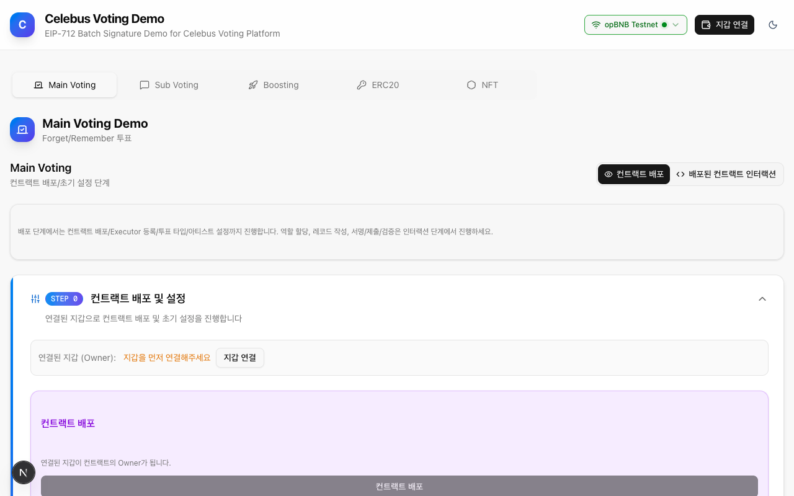
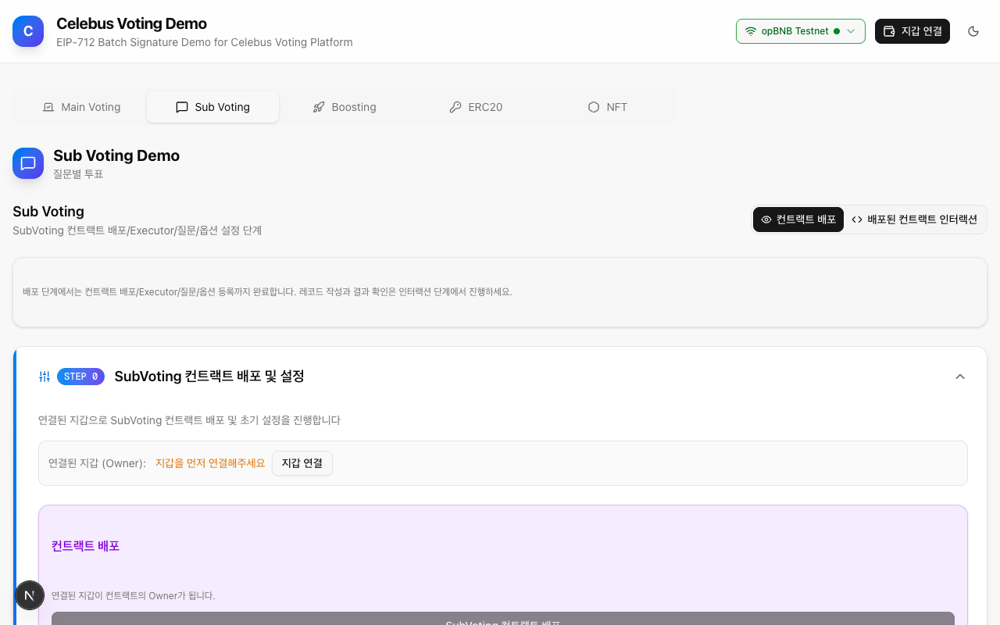
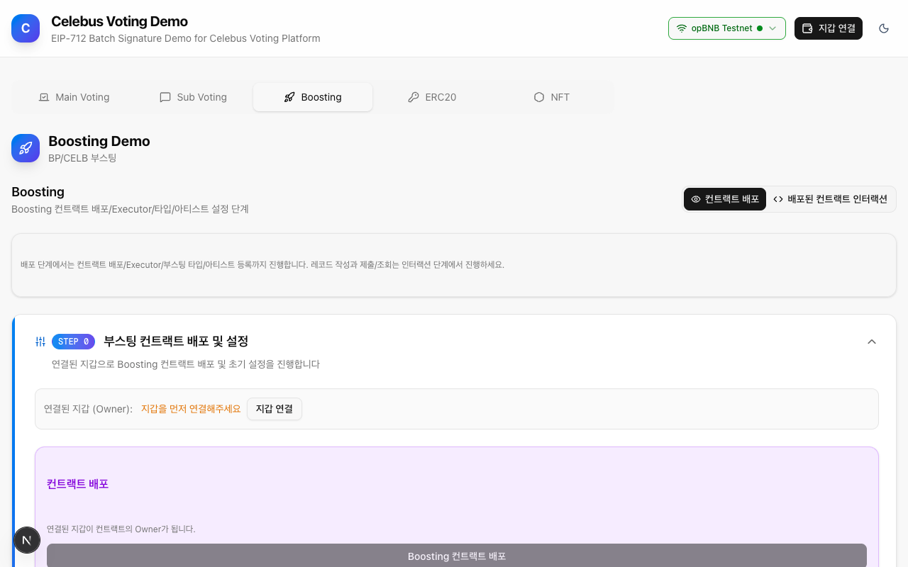
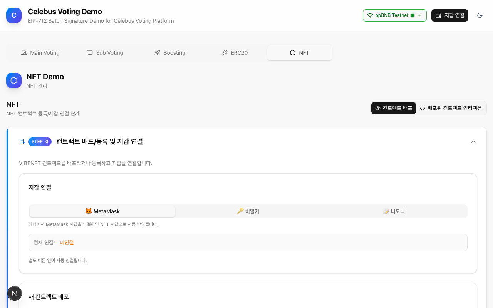
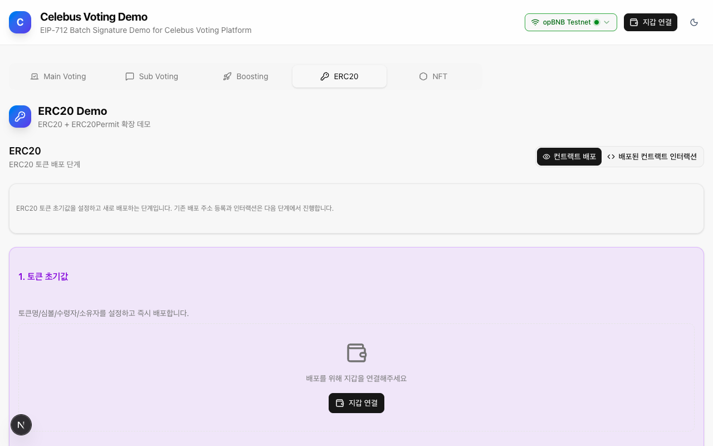
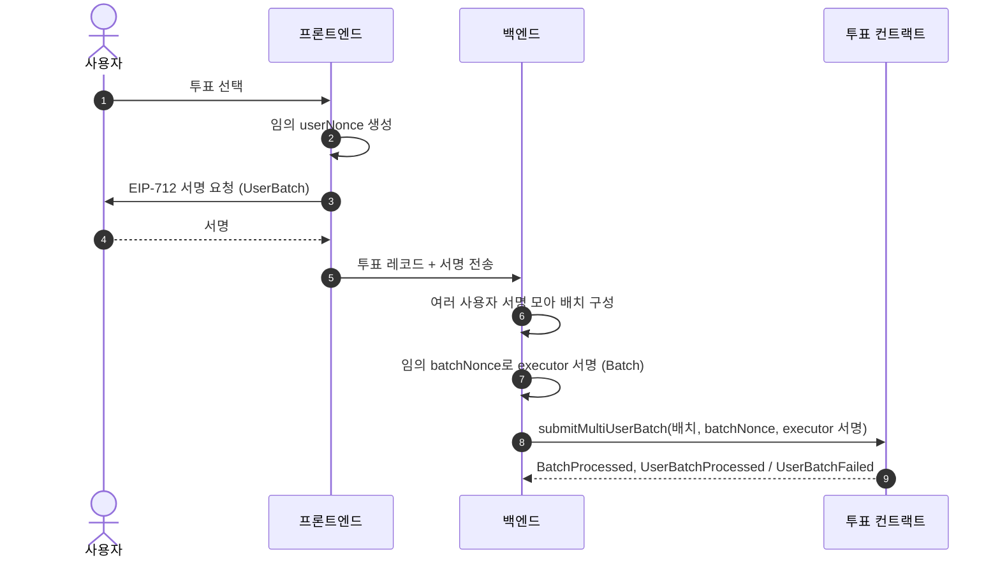
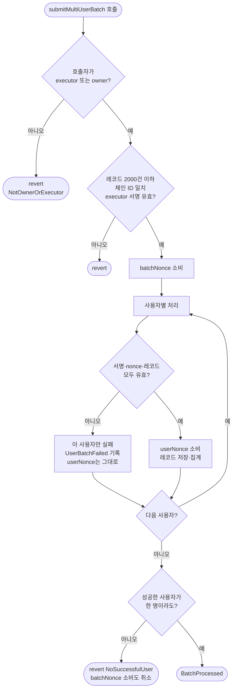

# BIVE Utility Contracts

여러 사용자의 투표 서명을 모아 트랜잭션 하나로 제출하는 EIP-712 배치 투표·부스팅 컨트랙트와, 팬덤 굿즈·티켓용 NFT 컨트랙트입니다.

> **이 저장소에 대해**
>
> 굿블록에서 K-pop 팬덤 플랫폼 Celebus용으로 혼자 설계하고 구현했습니다(2025.11 ~ 2026.08).
> 회사 저장소 최신본에서 컨트랙트, 테스트, 배포·부하 테스트 스크립트, 문서만 옮겼습니다. 데모 앱(`demo-next`)은 소스를 빼고 스크린샷만 남겼습니다.
>
> 공개하면서 투표 invariant 테스트 핸들러(`test/invariant/handlers`)를 고쳤습니다. 배치 제출을 executor만 할 수 있게 바꾼 뒤로 핸들러의 제출이 모두 권한 검사에 걸려, 투표 invariant가 실제로는 아무 호출도 검증하지 못하고 있었습니다. 핸들러가 executor로 제출하도록 하고, 유효하지 않은 레코드를 보낸 유저의 nonce는 소비되지 않는다는 현재 규칙에 기대값을 맞췄습니다. 컨트랙트 코드(`src/`)는 원본 그대로입니다.

```bash
git clone --recursive https://github.com/FDongFDong/bive-utility-contracts
cd bive-utility-contracts && forge test
```

## 컨트랙트

| 컨트랙트 | 하는 일 | 컴파일러 |
|---|---|---|
| **MainVoting** | 아티스트 대상 Remember/Forget 투표 | 0.8.30 |
| **SubVoting** | 질문-선택지 구조의 서브 투표 | 0.8.30 |
| **Boosting** | 토큰을 써서 아티스트를 부스팅 | 0.8.30 |
| **BIVENFT** | 굿즈 NFT (ERC-721, 잠금·일시정지) | 0.8.30 |
| **BIVETicketNFT** | 티켓 NFT (발행 즉시 잠금, 개별·배치 잠금 관리) | 0.8.35 |
| **CelebToken** | ERC-20 토큰 (EIP-2612 Permit) | 0.8.30 |

컴파일러 버전은 `foundry.toml`의 `compilation_restrictions`로 파일별로 고정했습니다. BIVETicketNFT를 0.8.35로 따로 묶은 이유는 기존 컨트랙트의 배포 바이트코드를 바꾸지 않기 위해서입니다.

## 데모 앱 스크린샷

블록체인을 잘 모르는 팀원과 흐름을 맞추려고 만든 플레이그라운드입니다. 배치 서명, 투표, 부스팅, NFT, Permit을 화면에서 직접 실행해 볼 수 있었습니다(Next.js 16, viem, shadcn/ui). 소스는 이 저장소에 없습니다.

| Main Voting | Sub Voting | Boosting |
|:-----------:|:----------:|:--------:|
|  |  |  |

| NFT | ERC20 (Permit) |
|:---:|:--------------:|
|  |  |

## 왜 배치 투표인가

투표할 때마다 사용자가 트랜잭션을 보내면 사용자는 가스 토큰을 들고 있어야 하고, 서비스는 체인 혼잡에 그대로 노출됩니다. 이 컨트랙트에서는 사용자가 투표 내용에 서명만 합니다. 백엔드가 서명을 모아 executor 계정으로 한 번에 제출하고, 가스도 executor가 냅니다.



## 서명 구조 (EIP-712)

서명은 두 단계입니다. 사용자는 자기 레코드 묶음에, executor는 배치 전체에 서명합니다.

```solidity
// 레코드 1건 (컨트랙트마다 필드가 다름)
// MainVoting
VoteRecord(uint256 timestamp,uint256 missionId,uint256 votingId,uint256 optionId,uint8 voteType,uint256 votingAmt,address user)
// SubVoting
VoteRecord(uint256 timestamp,uint256 missionId,uint256 votingId,uint256 questionId,uint256 optionId,uint256 votingAmt,address user)
// Boosting
BoostRecord(uint256 timestamp,uint256 missionId,uint256 boostingId,uint256 optionId,uint8 boostingWith,uint256 amt,address user)

// 사용자 묶음: recordsHash = keccak256(abi.encodePacked(recordDigests))
UserBatch(address user,uint256 userNonce,bytes32 recordsHash)

// executor 배치
Batch(uint256 batchNonce)
```

- 레코드의 `recordId`와 `userId` 문자열은 서명 대상이 아닙니다. 백엔드 식별용이라 서명 해시를 가볍게 유지했습니다.
- 사용자가 EOA면 ECDSA로, 컨트랙트 지갑이면 ERC-1271 `isValidSignature`로 검증합니다.
- `userNonce`와 `batchNonce`는 순서대로 올라가는 값이 아니라 임의 값입니다. 쓰였는지만 기록하므로 여러 배치를 동시에 만들어도 서로 막지 않습니다.

## 온체인 처리 순서

`submitMultiUserBatch`는 사용자 단위로 실패를 격리합니다. 한 사용자의 배치가 틀려도 나머지 사용자는 처리되고, 한 사용자 안에서는 레코드가 전부 성공하거나 전부 실패합니다.



## 보안 설계

**재사용(replay) 방지**

| 막으려는 것 | 장치 |
|---|---|
| 다른 체인·다른 컨트랙트에서 서명 재사용 | EIP-712 도메인에 체인 ID와 컨트랙트 주소가 들어감. 배포 시 저장한 `CHAIN_ID`와 호출 시점 체인 ID도 비교 (`BadChain`) |
| 같은 배치 재제출 | `usedBatchNonces[executor][nonce]` |
| 같은 사용자 서명 재사용 | `usedUserNonces[user][nonce]` |
| 같은 레코드 중복 반영 | `consumed` 매핑에 레코드 해시 기록 |

**권한**

- owner: 설정 변경만 합니다. `Ownable2Step`이라 새 owner가 수락해야 넘어갑니다.
- executor: 배치 제출만 합니다. 제출은 executor 또는 owner만 할 수 있습니다.
- 사용자: 자기 레코드에만 서명합니다.

**2026년 7월에 고친 취약점**

직접 찾아 PoC로 재현한 뒤 세 컨트랙트에서 함께 고쳤고, 회귀 테스트로 고정했습니다.

| 문제 | 수정 | 회귀 테스트 |
|---|---|---|
| 수량 상한이 없어 집계 값이 넘칠 수 있음 (오버플로 DoS) | 레코드당 `MAX_VOTING_AMT = 1e30` | 세 보안 테스트 파일의 `MaxVotingAmtRejectedNoDoS`, `Boundary*` |
| 누구나 제출할 수 있어 남이 batchNonce를 먼저 써 버릴 수 있음 (front-run) | executor·owner만 제출 | 세 보안 테스트 파일의 `ThirdPartyCannotFrontRun` |
| 레코드 검증 전에 userNonce를 소비해, 실패한 사용자가 같은 서명으로 재시도할 수 없음 | 사전 검증을 통과한 뒤에만 nonce 소비 | `NonceSurvivesAtomicFailureAndRetryWorks`, 투표 invariant |

세 보안 테스트 파일은 `MainVotingOverflowDoS.t.sol`, `SubVotingSecurity.t.sol`, `BoostingSecurity.t.sol`입니다.

## 제한값

| 항목 | 값 | 설명 |
|---|---|---|
| `MAX_RECORDS_PER_BATCH` | 2000 | 배치당 최대 레코드 수 (넘으면 revert) |
| `MAX_RECORDS_PER_USER_BATCH` | 20 | 사용자당 최대 레코드 수 (넘으면 그 사용자만 실패) |
| `MAX_STRING_LENGTH` | 100 | `userId` 최대 길이 |
| `MAX_VOTE_TYPE` | 1 | 0 = Forget, 1 = Remember (MainVoting) |
| `MAX_VOTING_AMT` | 1e30 | 레코드당 최대 수량 |

## 실패 사유 코드

세 컨트랙트가 `src/vote/lib/ReasonCodes.sol` 하나를 공유합니다. 값이 바뀌면 이미 남은 이벤트 로그의 의미가 달라지므로 `test/ReasonCodes.t.sol`이 값을 리터럴로 고정합니다.

| 코드 | 이름 | 뜻 |
|---|---|---|
| 0 | `NONE` | 성공 |
| 1 | `USER_BATCH_TOO_LARGE` | 사용자 레코드가 0개이거나 20개 초과 |
| 2 | `INVALID_USER_SIGNATURE` | 사용자 서명 불일치 |
| 3 | `USER_NONCE_INVALID` | 이미 쓴 userNonce |
| 4 | `INVALID_TYPE` | 잘못된 투표 타입(Main) 또는 부스팅 타입(Boosting) |
| 5 | `TARGET_NOT_ALLOWED` | 허용되지 않은 아티스트(Main, Boosting) 또는 질문(Sub) |
| 6 | `STRING_TOO_LONG` | `userId` 길이 초과 |
| 7 | `DUPLICATE_RECORD` | 이미 저장됐거나 배치 안에서 중복된 레코드 |
| 8 | `ZERO_AMOUNT` | 수량 0 |
| 9 | `VOTING_ID_MISMATCH` | 한 사용자 묶음 안에서 votingId 불일치 |
| 10 | `INVALID_OPTION_ID` | optionId 0 |
| 11 | `AMOUNT_TOO_LARGE` | 수량이 `MAX_VOTING_AMT` 초과 |
| 12 | `OPTION_NOT_ALLOWED` | 허용되지 않은 선택지 (SubVoting) |

## 가스

MainVoting에서 사용자당 레코드 1건으로 잰 실행 가스입니다. Foundry 테스트 안에서 `gasleft()` 차이로 쟀고, 트랜잭션 기본 비용과 calldata 비용은 빠져 있습니다.

| 구성 | 실행 가스 | 사용자당 |
|---|---|---|
| 1명 × 1건 (1회 제출) | 375,646 | 375,646 |
| 100명 × 1건 (1회 제출) | 29,003,489 | 약 290,035 |

- 100명이 각자 제출하면 실행 가스만 약 3,756만이고, 배치로 내면 약 2,900만입니다. 실행 가스 기준 약 23% 줄어듭니다.
- 각자 제출할 때 트랜잭션마다 붙는 기본 비용 21,000까지 더하면 약 27% 줄어듭니다.
- 줄어드는 몫은 배치마다 한 번만 하는 executor 서명 검증과 batchNonce 처리에서 나옵니다. 사용자별 서명 검증과 레코드 저장은 배치여도 사용자 수만큼 듭니다.
- 사용자는 가스를 내지 않습니다. 서명만 하고, 가스는 executor 한 계정이 냅니다.

그 밖의 최적화:

- EIP-712 구조체 해시를 `abi.encode` 대신 memory-safe inline assembly로 계산합니다.
- 루프 인덱스는 `unchecked { ++i; }`로 증가시킵니다(상한 2000이라 안전).
- 레코드 검증을 저장 전에 끝내, 실패한 사용자 배치는 스토리지를 쓰지 않습니다.

## 백엔드 연동

| 쪽 | 하는 일 |
|---|---|
| 프론트엔드 | 임의 `userNonce` 생성(타임스탬프·난수 등), 필요하면 `usedUserNonces`로 중복 확인, EIP-712 서명 요청, 서명을 백엔드로 전송 |
| 백엔드 | 서명 모으기, 배치 구성, 임의 `batchNonce`로 executor 서명, 제출, 실패 이벤트 확인 |

조회 함수:

```solidity
function usedUserNonces(address user, uint256 nonce) external view returns (bool);
function usedBatchNonces(address executor, uint256 nonce) external view returns (bool);
function domainSeparator() external view returns (bytes32);

// MainVoting
function getArtistAggregates(uint256 missionId, uint256 optionId) external view returns (uint256 remember, uint256 forget, uint256 total);
function getVoteSummariesByMissionVotingId(uint256 missionId, uint256 votingId) external view returns (VoteRecordSummary[] memory);

// SubVoting: getOptionVotes, getQuestionTotalVotes, getQuestionAggregates, getVoteSummariesByMissionVotingId
// Boosting: getBoostAggregates, getBoostSummariesByBoostingId
```

## 배포 정보

- 네트워크: opBNB Testnet (Chain ID 5611)
- 탐색기: https://testnet.opbnbscan.com/

## 빠른 시작

```bash
git clone --recursive https://github.com/FDongFDong/bive-utility-contracts
cd bive-utility-contracts

forge build
forge test
```

`--recursive` 없이 받았다면 `git submodule update --init --recursive`로 forge-std와 OpenZeppelin을 받습니다.

자주 쓰는 실행 방법:

```bash
forge test --match-contract MainVotingTest    # 컨트랙트 하나만
forge test --match-path "test/invariant/*"    # invariant만 (몇 분 걸림)
forge test --gas-report                       # 가스 리포트

# 2000건 경계 테스트는 무거워서 기본 실행에서는 건너뜁니다
RUN_HEAVY_BOUNDARY_TESTS=true forge test --match-test 2000

# BIVETicketNFT는 0.8.35 전용 프로파일로 (산출물은 out-ticket/에 따로 생김)
FOUNDRY_PROFILE=ticket forge test --match-path test/BIVETicketNFT.t.sol
```

**검증**

- GitHub Actions(`.github/workflows/test.yml`)가 push마다 포맷 검사, 빌드, 전체 테스트, 티켓 NFT 전용 빌드·테스트를 돌립니다.
- `npm run verify:contracts`(`scripts/verify.sh contracts`)는 배포된 6개 컨트랙트를 solc로 다시 컴파일해 바이트코드가 비트 단위로 같은지 확인합니다. 소스가 배포본과 어긋나는 상황은 이 검사로만 잡힙니다. 검사 목록과 이유는 스크립트 주석에 있습니다. 같은 스크립트의 `demo` 항목은 데모 앱이 없어서 이 저장소에서는 돌지 않습니다.

## 테스트

전체 369개, 모두 통과합니다.

| 파일 | 개수 | 다루는 것 |
|---|---|---|
| `MainVoting.t.sol` | 58 | 배포·설정, 단일·다중 사용자 제출, 서명·nonce 실패, Soft-fail과 부분 성공, 이벤트, ERC-1271, 제한값, Ownable2Step |
| `SubVoting.t.sol` | 56 | 질문·선택지 설정, 제출, 검증 실패, 원자성(nonce 소비 시점, votingId 불일치), ERC-1271, 제한값 |
| `Boosting.t.sol` | 53 | 아티스트·부스팅 타입 설정, 제출, 검증 실패, 집계, ERC-1271, 비활성화·재활성화 |
| `BIVENFT.t.sol` | 100 | 발행·배치 발행, URI, 잠금, 잠금 상태 전송 제한, 소각, 일시정지, 가스 벤치마크 |
| `BIVETicketNFT.t.sol` | 38 | 발행 즉시 잠금, 배치 발행, 잠금·해제 후 전송, URI, 권한 |
| `CelebTokenPermit.t.sol` | 14 | Permit 성공·실패, 값 변조, permit 선점 시나리오 |
| `MainVotingOverflowDoS.t.sol` | 5 | 수량 상한 DoS, 경계값, 제3자 front-run, nonce 보존 후 재시도, 정상 누적 대조군 |
| `SubVotingSecurity.t.sol` | 3 | 수량 상한 DoS, 경계값, 제3자 front-run |
| `BoostingSecurity.t.sol` | 3 | 수량 상한 DoS, 경계값, 제3자 front-run |
| `UserVoteResultEvent.t.sol` | 8 | 사용자별 성공·실패 이벤트 |
| `ReasonCodes.t.sol` | 2 | 실패 사유 코드 값 고정 |
| `HashDebug.t.sol` | 2 | 해시 계산, free memory pointer |
| invariant 5개 파일 | 27 | 아래 표 |

**invariant 테스트** (실행 256회 × 호출 500번)

| 파일 | 개수 | 지키는 것 |
|---|---|---|
| `MainVoting.invariant.t.sol` | 3 | 아티스트 집계가 기대값과 같음, batchNonce·userNonce 소비 기록이 맞음 |
| `SubVoting.invariant.t.sol` | 3 | 질문별 집계, nonce 소비 기록 |
| `Boosting.invariant.t.sol` | 3 | 부스팅 집계, nonce 소비 기록 |
| `BIVENFT.invariant.t.sol` | 9 | 모든 토큰에 소유자 있음, 소각 토큰 없음, 잠금 일관성, 일시정지 동작, 토큰 ID 순서 |
| `BIVETicketNFT.invariant.t.sol` | 9 | 잠긴 토큰 전송·남의 소각·일시정지 중 동작이 한 번도 성공하지 않음 |

티켓 NFT invariant는 금지된 동작을 핸들러가 실제로 시도하고 성공 횟수가 0인지 셉니다. 아무것도 하지 않아서 통과하는 테스트가 되지 않도록 하기 위해서입니다.

## 배포 명령 (opBNB Testnet)

```bash
export PRIVATE_KEY=<YOUR_PRIVATE_KEY>
export RPC_URL=https://opbnb-testnet-rpc.bnbchain.org

forge script script/DeployMainVoting.s.sol:DeployMainVoting --rpc-url $RPC_URL --private-key $PRIVATE_KEY --broadcast
forge script script/DeploySubVoting.s.sol:DeploySubVoting --rpc-url $RPC_URL --private-key $PRIVATE_KEY --broadcast
forge script script/DeployBoosting.s.sol:DeployBoosting --rpc-url $RPC_URL --private-key $PRIVATE_KEY --broadcast
forge script script/DeployNFT.s.sol:DeployNFT --rpc-url $RPC_URL --private-key $PRIVATE_KEY --broadcast

# 티켓 NFT는 공개 바이트코드와 같은 0.8.35 프로파일로
FOUNDRY_PROFILE=ticket forge script script/DeployTicketNFT.s.sol:DeployTicketNFT --rpc-url $RPC_URL --private-key $PRIVATE_KEY --broadcast
```

ABI는 빌드 산출물에서 꺼냅니다:

```bash
jq '.abi' out/MainVoting.sol/MainVoting.json > MainVoting-abi.json
```

탐색기 검증용 Standard JSON Input:

```bash
forge verify-contract <ADDRESS> src/vote/MainVoting.sol:MainVoting \
    --chain opbnb-testnet --show-standard-json-input > MainVoting-standard-json-input.json
```

## 부하 테스트 스크립트

대량 투표의 서명과 제출을 명령 하나로 돌립니다. 자세한 옵션은 `scripts/README.md`와 `STRESS_TEST_GUIDE.md`에 있습니다.

```bash
export PRIVATE_KEY=<YOUR_PRIVATE_KEY>
export VOTING_ADDRESS=<MAINVOTING_ADDRESS>
export RPC_URL=https://opbnb-testnet-rpc.bnbchain.org

# 130명 × 1표, 총 140건을 10회 동시에 제출
npm run stress:burst -- --count 10 --totalVotes 140 --userCount 130 --missionId 1

# 새 MainVoting 배포 → executor 설정 → 서명 → 제출까지 한 번에
TOTAL_VOTES=130 USER_COUNT=130 scripts/run-stress.sh
```

- `stress:burst`는 `stress-artifacts/`에 만든 JSON을 차례로 제출하고, 배치마다 `votingId` 표본을 최대 10개 남깁니다.
- `--gasBumpPercent`(기본 10)로 대체 트랜잭션의 가스를 올립니다.
- `run-stress.sh`는 마지막에 컨트랙트 주소, 생성한 JSON 경로, 제출 트랜잭션 해시를 정리해 보여 줍니다.

## 프로젝트 구조

```
.
├── src/
│   ├── vote/
│   │   ├── MainVoting.sol
│   │   ├── SubVoting.sol
│   │   ├── Boosting.sol
│   │   └── lib/
│   │       ├── ReasonCodes.sol        # 실패 사유 코드 (세 컨트랙트 공유)
│   │       └── SignatureVerifier.sol  # ECDSA / ERC-1271 검증
│   ├── nft/
│   │   ├── BIVENFT.sol
│   │   └── BIVETicketNFT.sol
│   ├── token/CelebToken.sol
│   └── common/IERC1271.sol
├── test/
│   ├── *.t.sol                        # 단위·보안 테스트 (342개)
│   ├── invariant/                     # invariant 테스트 (27개)와 핸들러
│   └── mocks/                         # ERC-1271 지갑, ERC-721 수신자 Mock
├── script/                            # 배포 스크립트
├── scripts/                           # 부하 테스트, verify.sh
├── docs/images/                       # 데모 앱 스크린샷
└── lib/                               # forge-std v1.11.0, OpenZeppelin v5.5.0 (서브모듈)
```

## 기술 스택

- Solidity 0.8.30 / 0.8.35 (via-IR, EVM prague)
- Foundry (forge test, invariant, fuzz)
- OpenZeppelin Contracts 5.5.0
- EIP-712, EIP-2612, ERC-1271
- 부하 테스트: Node.js, viem

## 라이선스

MIT

## 참고

- [Foundry Book](https://book.getfoundry.sh/)
- [EIP-712](https://eips.ethereum.org/EIPS/eip-712)
- [opBNB 문서](https://docs.bnbchain.org/bnb-opbnb/)
